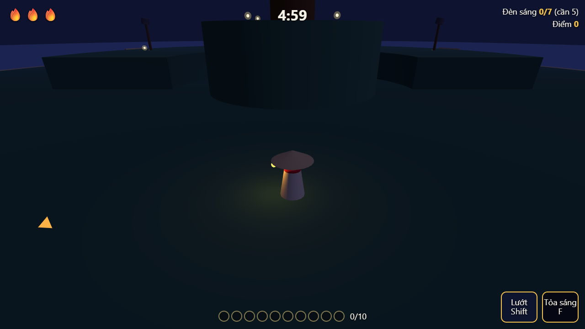

# Đảo Đèn Lồng

> **🎬 Video demo:** [demo.mp4 trong Release v1.0.0](https://github.com/Minh8246/K5-L3A-DAY12-VuQuangMinh-2A202603657-AI-SDLC-Dao-Den-Long/releases/tag/v1.0.0)
> Day 12 AI SDLC lab · Vũ Quang Minh · 2A202603657 · Test Contract **v1.3** · Phiên bản **1.0.0**



Game 3D góc nhìn thứ ba. Bạn là **Mây**, người giữ đèn nhỏ tuổi đội nón lá. Nhiệm vụ của bạn là gom **đom đóm** để thắp đèn và **giữ cho các Đèn Lồng Lớn còn dầu tới bình minh** trên ba hòn đảo. Trên đường đi, bạn phải né **Bóng Mực** (chúng hút dầu của đèn yếu) và **Gió Lạc** (chúng cướp đom đóm).

## Yêu cầu hệ thống

- macOS, Linux hoặc Windows 64-bit; GPU hỗ trợ WebGL 2.
- Node.js ≥ 18 (đã thử trên 20 và 24) cùng npm.
- Khoảng 400 MB dung lượng đĩa, chủ yếu là Electron, được tải về khi chạy `npm ci`.
- Bench cần có màn hình. Headless và soak thì không cần màn hình hay GPU.

## Cài đặt và chạy (3 lệnh)

```bash
npm ci
npm run build
npm start          # mở cửa sổ game 1280×720 (Electron)
```

Muốn chơi trên trình duyệt thì chạy `npm ci` rồi `npm run dev`. Bản web tĩnh nằm trong Release, xem mục [Bản phát hành](#bản-phát-hành-v100).

## Điều khiển (đổi được trong Cài đặt)

| Mặc định | Hành động |
|---|---|
| W A S D | Đi (theo hướng camera) |
| Kéo chuột trái / ← → | Xoay camera |
| Space | Nhảy |
| Shift | Lướt |
| E | Thắp đèn, thắp lại, hoặc châm dầu |
| F | Tỏa sáng: tốn 3 đom đóm, làm choáng Bóng Mực trong 5 m |
| Esc (hoặc P) | Tạm dừng |

## Luật chơi

- **Ba Đêm:** Đảo Bến (5 đèn, 240 s), Đảo Cau (6 đèn, 270 s), Đảo Chuông (7 đèn, 300 s).
- **Đèn và dầu:** đèn sáng có 100 dầu và hao 1 dầu/giây. Bóng Mực đứng cạnh đèn yếu (< 30 dầu) hút thêm 5 dầu/giây. Đèn hết dầu thì tắt; thắp lại chỉ tốn 5 đom đóm.
- **Thắng:** còn sống lúc bình minh và có ít nhất 60% số đèn đang sáng. **Thua:** hết Ngọn Lửa, hoặc tới bình minh mà chưa đủ đèn sáng.
- **Điểm:**
  - +5 cho mỗi đom đóm nạp vào đèn; +100 khi thắp lần đầu, +40 khi thắp lại.
  - Tỏa sáng trúng Bóng Mực: +5 mỗi con, +15 nếu con đó đang hút dầu.
  - Lúc bình minh, nếu thắng: mỗi đèn đang sáng được +50 cộng phần nguyên số dầu còn lại; mỗi Ngọn Lửa còn lại được +50.

Chi tiết luật và số liệu chuẩn có trong [docs/lab/](docs/lab/), các giả định ở [docs/notes/](docs/notes/).

## Bảng xếp hạng cục bộ

- **Lưu điểm:** sau màn Bình Minh hoặc sau khi thua, bạn nhập tên (3–12 ký tự gồm chữ, số, `_`; dùng được tiếng Việt có dấu). Bảng giữ top 10, sắp theo điểm giảm dần; bằng điểm thì ai đạt trước đứng trên. Xem bảng từ menu chính.
- **Nơi lưu:** bản desktop lưu vào `leaderboard.json` trong thư mục dữ liệu ứng dụng nên vẫn còn sau khi tắt game. Bản web lưu trong `localStorage`.
- **Xuất ra file:**
  ```bash
  npx electron . --export-leaderboard out.json     # → {"entries": [...]} đúng thứ tự
  ```

## Dễ tiếp cận

- **Đổi phím:** đổi được cho mọi hành động. Nếu hai hành động trùng phím, game báo ⚠ và tô đỏ. Có nút "Khôi phục mặc định". Cấu hình được lưu lại.
- **Phụ đề và chỉ báo hình ảnh** cho các sự kiện:
  - Bóng Mực xuất hiện (kèm mũi tên tím chỉ hướng ở mép màn hình);
  - gió sắp thổi;
  - còn 10 giây tới bình minh;
  - đèn sắp cạn dầu hoặc đã tắt.
- **Giảm chuyển động:** tắt rung camera, chớp màn hình và hiệu ứng nhấp nháy đồng hồ.
- **Cỡ chữ:** tối thiểu 18 px ở 1280×720; có tùy chọn **chữ lớn ×1.25**. Có thêm **bảng màu dễ phân biệt** cho người mù màu.

## Kiểm thử và chế độ headless

```bash
npm test           # 70 test unit + CLI + bench/soak/bảng xếp hạng
npm run verify     # 26 scenario headless (hồi quy Phase 1–3) + kiểm tra tất định → docs/proof/phase-4/
node src/headless.js --seed 1 --night 1 --ticks 600 --out out/run.jsonl [--scenario s.json] [--inputs i.json]
```

Mọi lệnh được khai báo trong [`game.contract.json`](game.contract.json). Một Đêm đầy đủ chạy headless dưới 1 giây.

## Benchmark

```bash
npx electron . --bench --seed 42 --duration 30 --out bench.json     # cần chạy npm run build trước
```

- **Cảnh đo:** chuẩn theo Ticket-04: Đêm 1, 200 Bóng Mực ở trạng thái wander, 100 đom đóm, đèn L1–L3 sáng với 100 dầu. Camera bay vòng bán kính 30 m, 15 s một vòng. Khởi động 3 s rồi đo 30 s.
- **Vsync đã tắt** bằng cờ Chromium `--disable-gpu-vsync --disable-frame-rate-limit`. Trên máy tác giả, số khung hình vượt xa tần số quét màn hình nên xác nhận được vsync đã tắt.
- **Độ phân giải:** render đúng **1280×720 pixel** (pixel ratio 1), không nhân theo mật độ màn hình.
- **`peak_mem_mb`:** tổng RSS (working set) của mọi tiến trình Electron (main, GPU, renderer), lấy mẫu mỗi 250 ms.
- **Phần sáng tạo thêm bị tắt** trong cảnh bench (vòng sáng vùng an toàn).
- Kết quả trên máy tác giả: [docs/proof/phase-4/bench.json](docs/proof/phase-4/bench.json) (Intel Core Ultra 5 125H, GPU tích hợp Intel Arc, Windows 11). Số đo chính thức là số trên máy chấm.

## Soak test

```bash
node --expose-gc --max-semi-space-size=1 src/soak.js --seed 7 --nights 10 --out soak.json
```

- **Cách chạy:** 10 Đêm liên tiếp xoay vòng 1 → 2 → 3, Đêm thứ i dùng seed 7 + i, input ngẫu nhiên theo seed. Kết quả: [docs/proof/phase-4/soak.json](docs/proof/phase-4/soak.json).
- **Cờ `--max-semi-space-size=1`:** giữ vùng nhớ young generation của V8 nhỏ. Chẩn đoán cho thấy heap thực dùng sau gc đứng yên quanh 4.2–4.5 MB qua 60 Đêm, nên **không có rò rỉ**. RSS tăng chỉ vì V8 nở thêm dung lượng dự trữ. Chi tiết ở [docs/notes/phase-4.md](docs/notes/phase-4.md).

## Bản phát hành v1.0.0

Release [v1.0.0](https://github.com/Minh8246/K5-L3A-DAY12-VuQuangMinh-2A202603657-AI-SDLC-Dao-Den-Long/releases/tag/v1.0.0) gồm:

- `dao-den-long-web-v1.0.0.zip`: thư mục web tĩnh. Giải nén rồi chạy `npx serve dist` (hoặc bất kỳ server tĩnh nào) và mở trình duyệt. Bản web không cần Node để chơi, nhưng dùng localStorage thay cho file.
- Bản desktop chạy từ mã nguồn bằng 3 lệnh ở trên.
- `demo.mp4`: video demo.

## Xử lý sự cố

- **`Cannot read properties of undefined (reading 'commandLine')` khi chạy Electron:** terminal đang đặt biến `ELECTRON_RUN_AS_NODE=1`, thường gặp trong terminal của một số công cụ dựa trên VS Code. Hãy chạy `env -u ELECTRON_RUN_AS_NODE npm start`, hoặc mở terminal khác.
- **Windows báo "Electron failed to install correctly":** xóa thư mục `node_modules/electron` rồi chạy lại `npm ci`. Phần mềm diệt virus có thể đã chặn bước giải nén.

## Sáng tạo của tôi

Toàn bộ nằm ở lớp hiển thị nên **không đổi output headless**. Phần nào là hiệu ứng thì bị tắt trong cảnh bench.

- Đom đóm đang mang bay vòng quanh nón lá của Mây.
- Vòng sáng trên mặt đất thể hiện vùng an toàn 6 m; vòng này tắt khi dầu < 30.
- Mỗi Đêm mở đầu bằng lời dặn của Ông Đăng.
- Âm thanh tự tổng hợp bằng WebAudio, không dùng file ngoài.
- Bảng xếp hạng nhận tên tiếng Việt có dấu.

Bằng chứng phần lõi không bị ảnh hưởng: `src/core/` không import gì từ `src/render/`, và mọi scenario vẫn PASS, output giống hệt nhau từng byte.

## Tài liệu dự án

| Phase | Spec, giả định, đánh giá | Bằng chứng (khớp tag) |
|---|---|---|
| 1 (Contract v1.0) | [phase-1.md](docs/notes/phase-1.md) | [proof/phase-1](docs/proof/phase-1/verify-report.md) |
| 2 (v1.1) | [phase-2.md](docs/notes/phase-2.md) | [proof/phase-2](docs/proof/phase-2/verify-report.md) |
| 3 (v1.2) | [phase-3.md](docs/notes/phase-3.md), [ADR-001](docs/notes/adr-001-fuel.md) | [proof/phase-3](docs/proof/phase-3/verify-report.md) |
| 4 (v1.3) | [phase-4.md](docs/notes/phase-4.md) | [proof/phase-4](docs/proof/phase-4/) (bench, soak, bảng xếp hạng, verify) |

- [CHANGELOG.md](CHANGELOG.md): các thay đổi phá vỡ tương thích của từng phase.
- [Retro](docs/notes/retro.md): tổng kết dự án.
- [Nhật ký dùng AI](docs/notes/ai-log.md).
- Harness AI: [CLAUDE.md](CLAUDE.md), skill [verify](.claude/skills/verify/SKILL.md), Stop hook [stop-gate.js](scripts/hooks/stop-gate.js), [CI](.github/workflows/ci.yml).

Giấy phép [MIT](LICENSE) · Nguồn và công cụ: [CREDITS.md](CREDITS.md).
